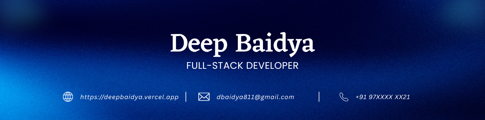

 

I'm <strong>Deep Baidya</strong>, a passionate Full Stack Developer with over 4 years of hands-on experience building resilient, high-performance web applications from the ground up. I specialize in the <strong>MERN stack</strong> and the broader <strong>Next.js</strong> ecosystem, crafting scalable <strong>Node.js</strong> backends, secure REST APIs, and clean, accessible <strong>React</strong> frontends with <strong>TypeScript</strong> and <strong>Tailwind CSS</strong>. I genuinely enjoy turning complex, real-world ideas into reliable, user-friendly products that not only perform well under heavy load but also scale smoothly as they grow. Writing clean, maintainable code and shipping software that people actually love using is what drives me every single day.

From designing low-latency <strong>API architectures</strong> and <strong>PostgreSQL</strong> and <strong>MongoDB</strong> database schemas to polishing intuitive user interfaces, I care deeply about code quality, performance, security, and measurable business impact. My toolkit also spans <strong>Express</strong>, <strong>Redis</strong>, and <strong>Docker</strong>, along with modern DevOps practices that keep applications reliable, fast, and easy to ship. Over the years I've delivered more than 24 production apps, always with a strong focus on clean architecture, 100% type-safe code, and dependable uptime. Beyond shipping features, I love collaborating with teams and mentoring developers on building fast, maintainable products.

I'm available globally for impactful remote work, freelance projects, and long-term collaboration across different time zones. Whether you want to launch a brand new product, scale an existing one, or simply say hello, I'd love to hear from you. You can reach me anytime at <strong>dbaidya811@gmail.com</strong>, and I'll always get back to you as quickly as I can. Let's build something great together!

 

&nbsp;&nbsp;&nbsp;&nbsp;&nbsp;&nbsp;&nbsp;&nbsp;&nbsp;&nbsp;&nbsp;&nbsp;

